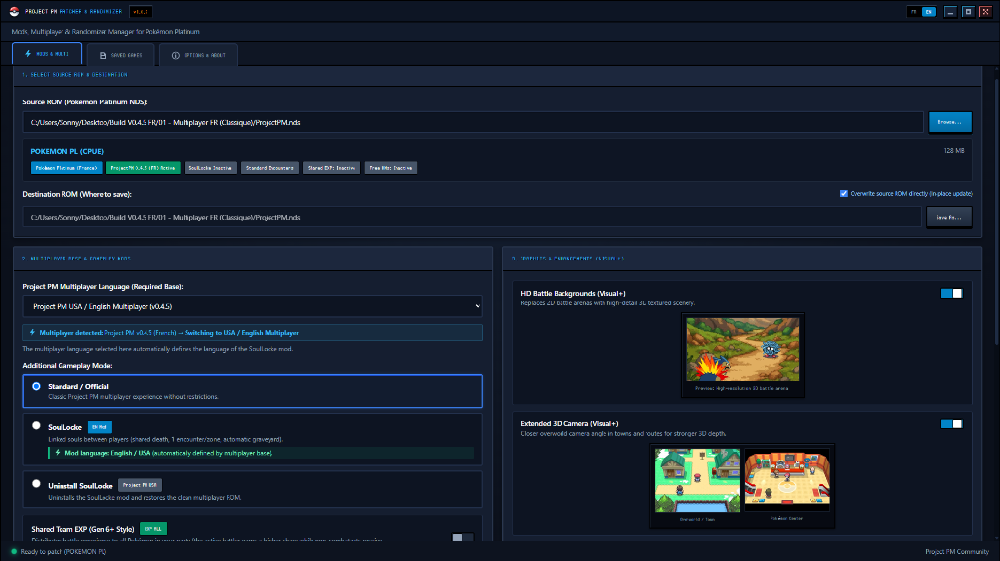
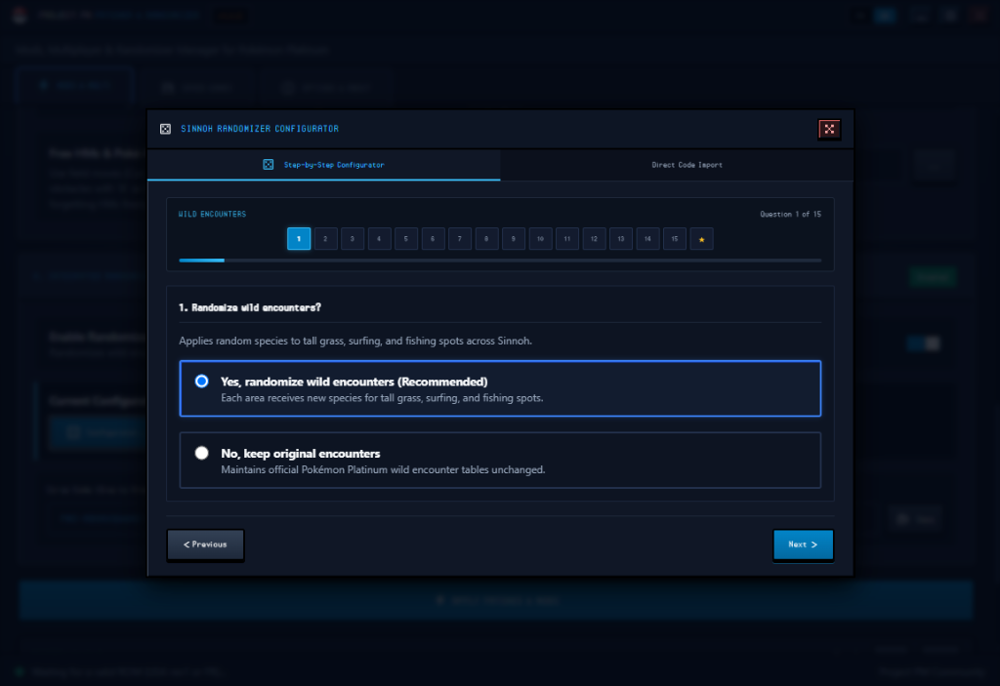

# ProjectPM Addon Patcher

[-0078D6?logo=windows)](https://github.com/Ekiiii/ProjectPM-Addon-Patcher/releases/latest)

> **Community mod and addon manager for Pokémon Platinum & Project PM.**  
> *Gestionnaire communautaire de mods et d'addons pour Pokémon Platine & Project PM.*

  

---

## English (EN)

### Overview
**ProjectPM Addon Patcher** lets you install, configure, and update community addons for Pokémon Platinum Multiplayer (Project PM) without dealing with xDelta checksum mismatches.

### Features
- **Direct ROM Patching**: Patches internal ROM files and code directly, whether starting from a clean vanilla ROM (USA Rev 1 or FR) or an already patched/randomized Project PM ROM (v0.4.5, v0.4.6, or v0.4.7).
- **In-Place Updates & Backups**: Updates your existing ROM in place while backing up your previous ROM and `.sav` / `.dsv` saves to `PMBackups/`.
- **Game Modes (Soul Link & Nuzlocke)**:
  - **Soul Link**: Linked pairs across party and PC slots, synchronized faints, automatic Graveyard boxes (Boxes 15–18), shared 1st-encounter rule per area, and an in-memory streamer status block.
  - **Nuzlocke**: Solo or co-op Nuzlocke rules (1st encounter per route, automatic Graveyard boxes 15–18 on faint, battle item block).
  - **One-Click Uninstaller**: Restores standard multiplayer behavior at any time without affecting your save file.
- **Quality of Life Patches**:
  - **Move Type Effectiveness Badges**: In-battle effectiveness capsules (`x4`, `x2`, `x1`, `x1/2`, `x1/4`, `x0`) on move buttons and target selection, including split badges in double battles.
  - **Shared Team EXP**: Grants 100% EXP to active battlers and 50% EXP to non-fainted bench Pokémon.
  - **Free HMs & Poké-Rider**: Use field moves on obstacles as soon as you own the required Gym Badge, without teaching HMs to your party, and freely overwrite HM moves.
  - **Infinite TMs & Solo Trade Evolutions**: TMs and Rare Candies are never consumed; trade evolutions trigger by level-up (Lv. 36) or direct item use.
  - **Fast HP/EXP Bars, Colored Natures & In-Game IV/EV Display**: Faster battle gauges, +Red / -Blue nature highlights on the summary screen, and `(A)` toggle on the stats page to view IVs and EVs.
- **Graphics Options**:
  - **Visual+ Battle Backgrounds & 3D Camera**: Custom battle scenes and closer 3D overworld camera perspective.
  - **Dynamic Overworld Engine (Experimental)**: Smooth day/night lighting transitions, drifting cloud shadows, and animated water reflections.
- **Co-Op Randomizer**:
  - Wild encounters (187 areas), starter trio (with sprite preview or mystery Pokéballs), 973 trainers & Gym Leaders, Pokémon types, abilities, level-up movesets, evolutions, Honey Trees, static legendaries, gift eggs, NPC trades, and custom shiny odds.
  - Shareable `PMC-...` Co-Op codes to keep trainer battles, evolutions, types, abilities, and movesets synchronized across all players.

  

### Quick Start
1. Download `ProjectPM-Addon-Patcher.exe` from the [Latest Release](https://github.com/Ekiiii/ProjectPM-Addon-Patcher/releases/latest).
2. Launch the application.
3. Select your source ROM (Pokémon Platinum USA Rev 1, Pokémon Platine FR, or an existing Project PM ROM).
4. Pick your language, game mode, QoL/visual patches, or randomizer settings.
5. Click **APPLY ADDONS & PATCH**.

---

## Français (FR)

### Vue d'ensemble
**ProjectPM Addon Patcher** permet d'installer, configurer et mettre à jour les addons communautaires pour Pokémon Platine Multijoueur (Project PM) sans erreur de checksum xDelta.

### Fonctionnalités
- **Patch Direct sur la ROM** : Applique les modifications directement dans les archives et binaires de la ROM, que vous partiez d'une ROM originale (Platine FR ou USA Rev 1) ou d'une ROM Project PM déjà moddée/randomisée (v0.4.5, v0.4.6 ou v0.4.7).
- **Mise à Jour sur Place & Sauvegardes** : Met à jour votre ROM actuelle tout en créant une copie de secours horodatée de la ROM et de vos sauvegardes `.sav` / `.dsv` dans `PMBackups/`.
- **Modes de Jeu (Soul Link & Nuzlocke)** :
  - **Soul Link** : Paires liées par slot d'équipe/PC, K.O. synchronisés, envoi automatique au Cimetière (boîtes PC 15 à 18), 1ère rencontre partagée par zone et bloc mémoire pour overlays streamers.
  - **Nuzlocke** : Règles Nuzlocke en solo ou en co-op (1ère rencontre par zone, envoi au Cimetière boîtes 15 à 18 en cas de K.O., blocage des objets en combat).
  - **Désinstallation en 1 clic** : Restaure les règles multijoueur classiques à tout moment sans toucher à votre sauvegarde.
- **Patchs Confort de Jeu (QoL)** :
  - **Badges d'Efficacité des Types en Combat** : Affiche les capsules `x4`, `x2`, `x1`, `x1/2`, `x1/4`, `x0` sur les boutons d'attaque et le choix des cibles (avec capsule bicolore en combat double).
  - **Multi Exp d'Équipe** : 100 % d'EXP pour les Pokémon ayant combattu, 50 % pour les Pokémon en réserve.
  - **CS Libres & Poké-Rider** : Utilisez les CS sur le terrain dès l'obtention du badge d'arène requis sans les enseigner à votre équipe, et effacez librement les CS.
  - **CT Infinies & Évolutions par Échange en Solo** : Les CT et le Super Bonbon ne sont plus consommés ; les évolutions par échange se déclenchent au niveau 36 ou en utilisant directement l'objet d'évolution.
  - **Barres PV/EXP Rapides, Natures Colorées & Affichage IV/EV** : Jauges de combat accélérées, statistiques colorées (+Rouge / -Bleu) selon la nature, et touche `(A)` sur l'écran résumé pour afficher les IVs et EVs.
- **Options Graphiques** :
  - **Arrière-plans de Combat & Caméra 3D Visual+** : Décors de combat retravaillés et caméra 3D rapprochée.
  - **Moteur Visuel Dynamique (Expérimental)** : Transitions d'éclairage jour/nuit, ombres de nuages au sol et reflets d'eau animés.
- **Randomizer Co-Op Intégré** :
  - Rencontres sauvages (187 zones), starters (avec aperçu des sprites ou Pokéballs mystères), 973 dresseurs et champions, types, talents, attaques par niveau, évolutions, arbres à miel, légendaires fixes, œufs, échanges PNJ et taux de Shiny.
  - Codes de partage Co-Op `PMC-...` pour synchroniser dresseurs, évolutions, types, talents et attaques entre tous les joueurs.

  

### Démarrage Rapide
1. Téléchargez `ProjectPM-Addon-Patcher.exe` depuis la [dernière Release](https://github.com/Ekiiii/ProjectPM-Addon-Patcher/releases/latest).
2. Lancez l'exécutable.
3. Sélectionnez votre ROM source (Platine France, Platinum USA Rev 1 ou une ROM Project PM existante).
4. Choisissez la langue, le mode de jeu, les options QoL/visuelles ou le randomizer.
5. Cliquez sur **APPLIQUER LES ADDONS & PATCHER**.

---

## License / Licence

This project is licensed under the **MIT License** - see the [LICENSE](LICENSE) file for details.

---

## Credits & Acknowledgements / Remerciements

- **[Project PM Team](https://github.com/Project-PM)** (nUt, MottledAbyss & Team) - Creators of the Pokémon Platinum Multiplayer romhack and melonDS multiplayer integration.
- **[ndspy](https://github.com/RoadrunnerWMC/ndspy)** by RoadrunnerWMC - Nintendo DS ROM parsing and packing library.
- **[xdelta3](https://github.com/jmacd/xdelta)** by Josh MacDonald - Binary differential patching tool.

---

## Legal Disclaimer / Avertissement Légal

- *This is an unofficial community project developed by Ekiii. It is not affiliated with, endorsed by, or sponsored by Nintendo, The Pokémon Company, Game Freak, or the core Project PM team.*  
- *Pokémon and Nintendo DS are registered trademarks of Nintendo, Creatures Inc., and GAME FREAK inc.*  
- *This tool does NOT contain or distribute copyrighted ROM files, game assets, or proprietary Nintendo code. Users must supply their own legally obtained ROM backups.*
